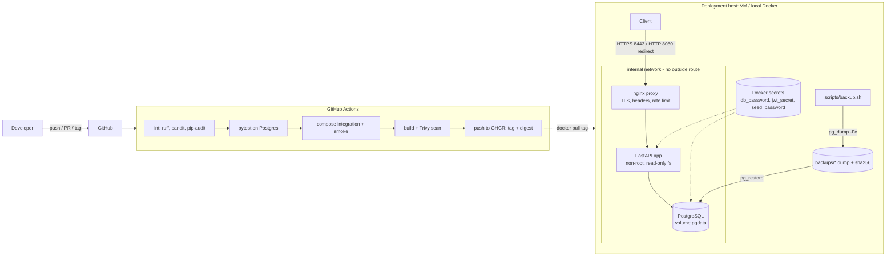

# Architecture

## Trust boundaries and exposure
- Only `proxy` publishes ports. `app` and `db` live on a Docker network marked `internal`, so they have no
  inbound exposure and no outbound internet route.
- `/metrics` is served by the app but blocked at the proxy (404).
- Containers: `no-new-privileges`, `cap_drop: ALL`; app has a read-only root filesystem and runs as uid 10001; nginx is the unprivileged image.

## Health model
| Check | Meaning | Used by |
|---|---|---|
| `/healthz` | process alive (no dependencies) | image HEALTHCHECK, proxy healthcheck |
| `/readyz` | can reach DB (503 otherwise) | Compose app healthcheck, deploy gate, smoke test |
| `pg_isready` | DB accepting connections | db healthcheck, `depends_on: service_healthy` |

## Data model
`users(role: admin|teacher|student)` · `students` · `classes(teacher_id)` · `enrollments(class_id, student_id)` ·
`attendance(class_id, student_id, att_date, session, status, recorded_by)` with FK to `enrollments`
and `UNIQUE(class_id, student_id, att_date, session)` · `audit_log`.

## Release flow
Tag `vX.Y.Z` → CI → image `ghcr.io/<owner>/<repo>:X.Y.Z` (+ `sha-<short>`, `latest` on main) with provenance + SBOM →
`scripts/deploy.sh X.Y.Z` (backup, pull, `up --wait`, smoke) → on failure automatic `rollback.sh`.
